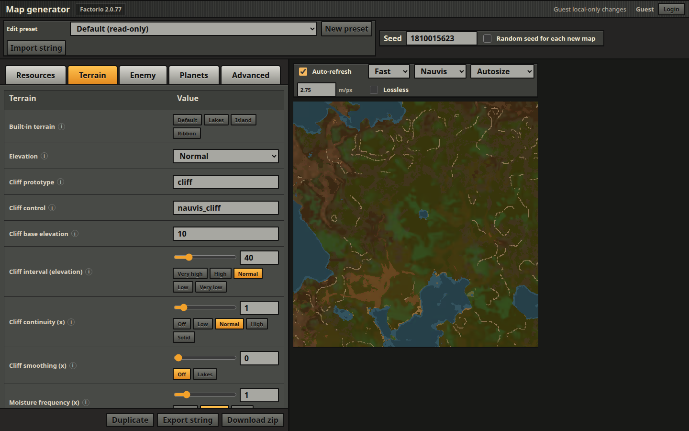

# FactMapGen

Preview Factorio and Space Age maps in your browser. Pick a seed, adjust the map settings, and share a preview link or export a map exchange string to use in Factorio.

[Try FactMapGen](https://mapgen.m45sci.xyz/)

## Fast preview accuracy

We compared Fast previews with Factorio 2.1.23 using two map seeds per planet at one tile per pixel. The table shows the average color difference on a scale from 0 to 255. Zero is an exact match. [Full accuracy report](docs/factorio-2.1-accuracy.md)

| Planet | Average color difference |
| --- | ---: |
| Nauvis | 0.0053–0.0112 |
| Vulcanus | 0.1394–0.2162 |
| Gleba | 0.0149–0.0164 |
| Fulgora | 0.0163–0.0282 |
| Aquilo | 0.0010–0.0017 |

Fast previews are available to guests. Exact previews use Factorio itself and are available when enabled by the server.

## License

Copyright © 2026 Carl Frank Otto III for original contributions. [AGPL-3.0-or-later](LICENSE)

The renderer includes work adapted from FactorioMapWebUI under the same license. [Upstream attribution](docs/upstream-rendering.md) · [Upstream fixture license](testdata/space-age-upstream/LICENSE)
