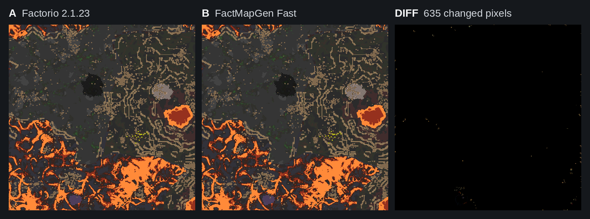
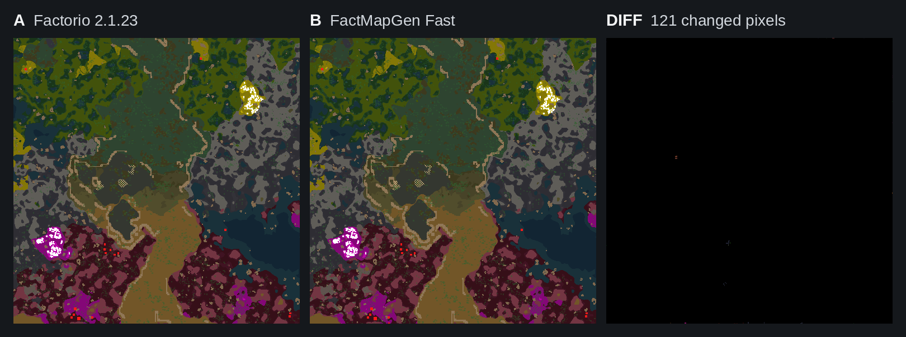
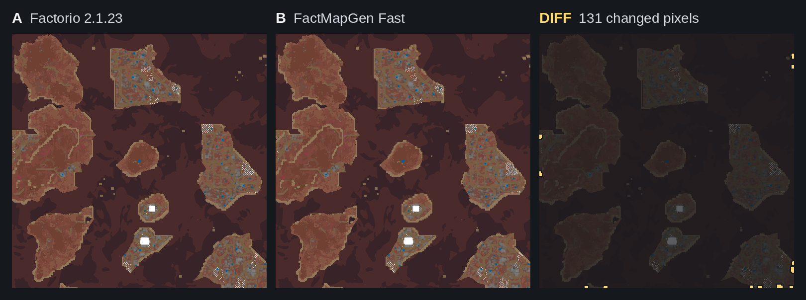

# Fast preview accuracy

We compared FactMapGen’s Fast previews with Factorio 2.1.23 Space Age previews for all five planets. Each comparison used two map seeds (`123456` and `987654321`) and a 512×512 image centered at the map origin, at one tile per pixel.

## Results by planet

The table shows the percentage of pixels that differed. Each cell lists seed `123456` first and seed `987654321` second. Full previews include features such as resources, plants, and enemies.

| Planet | Terrain only | Terrain and cliffs | Full preview |
| --- | ---: | ---: | ---: |
| Nauvis | 0.00114% / 0.00114% | 0.00114% / 0.00267% | 0.04005% / 0.07057% |
| Vulcanus | 0.03853% / 0.14381% | 0.18806% / 0.27313% | 0.24223% / 0.37918% |
| Gleba | 0% / 0% | 0.02747% / 0.02480% | 0.04616% / 0.03357% |
| Fulgora | 0% / 0% | 0.02289% / 0.02670% | 0.04997% / 0.05455% |
| Aquilo | 0% / 0% | 0% / 0% | 0.00420% / 0.00229% |

Fulgora’s terrain also matched a separate 1024×1024 reference pixel for pixel. Aquilo’s full-preview differences were all within two pixels of the image edge. Vulcanus had the largest differences of the five planets, including visible differences in terrain and cliffs.

Separate enemy-marker checks matched Factorio pixel for pixel in all six Nauvis and Gleba samples, including starting areas, distant areas, and settings with doubled enemy size and frequency. These checks used the center of a larger Factorio capture to account for image-edge effects.

These figures describe the sampled preview images. Results can vary with the seed, settings, and zoom. Fast previews approximate feature placement at wider zooms and have limited support for mods.

## Visual comparison

All five comparisons use seed `123456`. A is Factorio’s preview, B is FactMapGen’s Fast preview, and DIFF marks the pixels that changed. The markers are enlarged so individual differences are visible.

### Nauvis


### Vulcanus



### Gleba



### Fulgora



### Aquilo


## Run the comparison

From the repository root, run the five-planet test against the [saved Factorio previews](../testdata/planets-2.1.23).

```sh
FACTMAPGEN_ACCURACY_ARTIFACTS=1 go test -run '^TestPlanetReleaseAccuracy$' -v .
```

The test writes comparison images to `test-output/accuracy-2.1.23/`. For capture commands, renderer changes, and additional checks, see the [original technical audit](https://github.com/M45-Science/FactMapGen/blob/ea36c1a6e5ba9b65e749bb5ac9b58cd00c926ff4/docs/factorio-2.1-accuracy.md).
