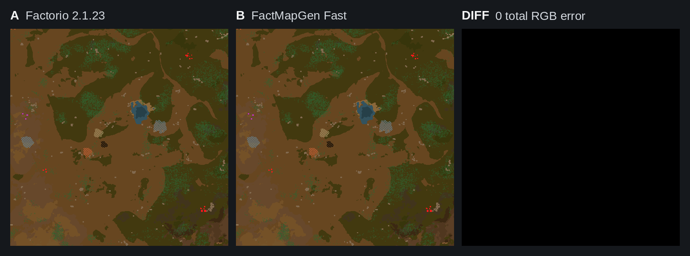

# Fast preview accuracy

FactMapGen’s standalone Fast previews matched Factorio 2.1.23 Space Age pixel for pixel on all five planets in the saved tests. The tests used seeds `123456` and `987654321` with 512×512 images centered at the map origin at one tile per pixel.

## Results by planet

Total RGB error adds up the absolute differences in red, green, and blue across the whole image. Zero means an exact match, including the edges. Each cell covers both seeds. Full previews include resources, plants, and enemies.

| Planet | Terrain only | Terrain and cliffs | Full preview |
| --- | ---: | ---: | ---: |
| Nauvis | 0 | 0 | 0 |
| Vulcanus | 0 | 0 | 0 |
| Gleba | 0 | 0 | 0 |
| Fulgora | 0 | 0 | 0 |
| Aquilo | 0 | 0 | 0 |

Fulgora’s terrain also matched a separate 1024×1024 reference pixel for pixel.

Two fresh captures per planet also matched pixel for pixel. Seed `424242` used default settings at 640×640. Seed `72239527` used different map controls for each planet and an offset 576×576 viewport. Its terrain and cliff layers matched as well. [Capture settings and image hashes](../testdata/planets-2.1.23/holdouts.json)

Five additional 256×256 Nauvis terrain checks matched across the Default, Lakes, and Island presets.

Separate enemy-marker checks matched Factorio pixel for pixel in all six Nauvis and Gleba samples, including starting areas, distant areas, and settings with doubled enemy size and frequency. These checks used the center of a larger Factorio capture to account for image-edge effects.

These figures describe the sampled preview images. The interactive map generates adjoining chunks so its tiles join seamlessly along the edges. Fast previews approximate feature placement at wider zooms and have limited support for mods.

## Visual comparison

All five comparisons use seed `123456`. A is Factorio’s preview and B is FactMapGen’s Fast preview. DIFF shows the absolute difference between their red, green, and blue values at each pixel. Identical pixels are black.

### Nauvis



### Vulcanus


### Gleba


### Fulgora


### Aquilo


## Run the comparison

From the repository root, run the five-planet test against the [saved Factorio previews](../testdata/planets-2.1.23).

```sh
FACTMAPGEN_ACCURACY_ARTIFACTS=1 go test -run '^TestPlanet(ReleaseAccuracy|StandaloneHoldout)$' -v .
```

The release test logs total and average RGB error and writes comparison PNGs to `test-output/accuracy-2.1.23/`. The holdout test checks the rendered pixels against the native image hashes. For capture commands, renderer changes, and additional checks, see the [original technical audit](https://github.com/M45-Science/FactMapGen/blob/ea36c1a6e5ba9b65e749bb5ac9b58cd00c926ff4/docs/factorio-2.1-accuracy.md).
